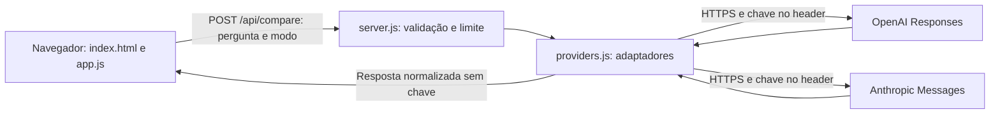

# LLM Lab — Grupo 2

**Desenvolvimento Web · Anatomia das APIs OpenAI × Anthropic · Valor: 6,0 pontos**

Aplicação didática que envia a mesma pergunta aos dois provedores e mostra endpoint, headers com credenciais removidas, body, texto, JSON de resposta, status HTTP, tempo e tokens. Interface em português, responsiva, sem dependências externas de runtime.

### Materiais incluídos

- [Apresentação de 8 slides em PowerPoint](docs/apresentacao-grupo2.pptx)
- [Roteiro de fala, divisão do tempo e pergunta-desafio](docs/roteiro.md)
- [Coleção para importar no Postman](examples/grupo2.postman_collection.json)
- [Comandos curl](examples/curl.md)
- [Registro para preencher com resultados reais](docs/resultados.md)
- [Print do ensaio simulado — não é evidência de API real](docs/preview-simulado.png)

## Executar

Requisito: **Node.js 22 ou superior**. No terminal, dentro desta pasta:

```sh
npm start
```

Abra http://127.0.0.1:3000. O modo **Ensaio · simulado** funciona sem chaves ou internet; suas respostas e contagens são fixas e fictícias. Não serve como evidência de chamadas reais. Não é necessário `npm install`, pois usamos apenas módulos nativos do Node.

### Ativar as APIs reais

1. Copie `.env.example` para `.env` (`Copy-Item .env.example .env` no PowerShell; `cp .env.example .env` no Bash).
2. Preencha `OPENAI_API_KEY` e `ANTHROPIC_API_KEY` somente nesse arquivo local. Cada provedor exige acesso à API e saldo/limites disponíveis.
3. Confira os modelos habilitados na sua conta e ajuste `OPENAI_MODEL` e `ANTHROPIC_MODEL` se necessário.
4. Reinicie `npm start`, selecione **APIs reais · usa créditos** e clique em **Comparar respostas**. Cada clique faz até duas requisições pagas.
5. Confira `2/2 provedores responderam`. Baixe a evidência JSON e capture a tela com as respostas e detalhes abertos. Revise também a pergunta e a resposta para não publicar dados pessoais.

Não existe fallback silencioso: falhas no modo real aparecem como falhas. Se apenas um provedor responder, sua resposta permanece disponível.

## Entrega do Grupo 2

| Critério | Pontos | Material e ação |
|---|---:|---|
| Domínio e clareza | 1,8 | Apresentação, comparação abaixo e explicação dos dois contratos |
| Demonstração/resultado | 1,8 | App + coleção Postman + exemplos curl; executar com ambas as chaves e guardar evidência real |
| Segurança e boas práticas | 1,2 | `.env`, `.gitignore`, credenciais no servidor, limite, timeout e testes |
| Participação e perguntas | 0,6 | Divisão de fala e desafio em `docs/roteiro.md` |
| Repositório e README | 0,6 | Código organizado, comandos de execução, testes e documentação |

A nota depende da execução e da explicação de vocês; o material não substitui o ensaio. Preencham os nomes e a data real da próxima aula no roteiro.

## Anatomia das requisições

| Parte | OpenAI Responses | Anthropic Messages |
|---|---|---|
| Método | POST | POST |
| Endpoint | `https://api.openai.com/v1/responses` | `https://api.anthropic.com/v1/messages` |
| Autenticação usada | `Authorization: Bearer …` | `x-api-key: …` |
| Formato | `Content-Type: application/json` | `Content-Type: application/json` |
| Versão usada | Rota `/v1` | Header `anthropic-version: 2023-06-01` |
| Pergunta | `input` | `messages[0].content` |
| Instrução | `instructions` | `system` |
| Limite de saída | `max_output_tokens` | `max_tokens` |
| Extração de texto | Blocos `output[].content[]` com `type: output_text` | Blocos `content[]` com `type: text` |
| Uso | `usage.input_tokens`, `usage.output_tokens` | `usage.input_tokens`, `usage.output_tokens` |

Um endpoint é o endereço de uma operação. Headers carregam metadados; o body JSON carrega os parâmetros. A resposta tem status HTTP e, normalmente, um body JSON. Os contratos dos provedores são diferentes mesmo quando a pergunta é igual. A versão Anthropic é explícita e configurável; os exemplos deste projeto preservam o contrato `2023-06-01`, sem afirmar que é a versão mais nova.

## Arquitetura e baixo acoplamento



É um sistema distribuído porque processos separados se comunicam pela rede. O front-end conhece apenas nosso contrato `/api/compare`. `providers.js` traduz os contratos externos para `{ provider, ok, text, usage, status, elapsedMs }`, reduzindo o acoplamento da interface aos fornecedores. A tela de inspeção também recebe uma cópia segura do pedido e do JSON para fins didáticos.

## Postman e curl

Importe `examples/grupo2.postman_collection.json`. Preencha as variáveis de chave **localmente**, preferencialmente usando o Vault do Postman. Não sincronize, exporte nem fotografe valores secretos. A coleção enviada neste repositório contém apenas referências a variáveis vazias. Ela tem duas chamadas diretas aos provedores e uma ao nosso back-end.

Os exemplos em `examples/curl.md` usam a mesma pergunta e instrução. Para uma apresentação sem risco de capturar a chave nos headers do Postman, mostre o resultado no app, que remove as credenciais antes de enviá-las ao navegador.

## Comparação justa e evidências

Use a mesma pergunta, instrução e limite de saída. Registre os modelos retornados, horário, status, texto e tokens. `elapsedMs` é o tempo da chamada medido no nosso back-end, não apenas o tempo de geração. Modelos podem ter tokenizadores diferentes; tokens não são palavras, e o mesmo limite não garante respostas de mesmo tamanho. Uma execução não demonstra superioridade geral nem custo menor. Para custo, consulte as tabelas oficiais do modelo; este projeto não inventa preços.

Avaliem clareza, correção do conceito, presença de exemplo e cumprimento de 120 palavras. Guardem as respostas antes de concluir. Não preenchemos resultados reais sem executá-los. Veja `docs/resultados.md`.

## Segurança e limitações

- A chave não é enviada pelo navegador; somente o back-end a lê do ambiente. `.env` não é servido e está ignorado pelo Git. `.gitignore` não remove um segredo que já foi commitado.
- Se houver vazamento, revogue a chave no provedor imediatamente, gere outra, confira o uso e remova o segredo do histórico. Apagar apenas a última versão não basta.
- Limite local: 10 comparações por minuto por processo (até 20 chamadas aos provedores). Não substitui os limites de cada API. Reiniciar o servidor reinicia o contador.
- Timeout de 45 segundos por provedor; limite de 2.000 caracteres na pergunta e de 16 KB no body. Erros externos não são repassados integralmente, pois podem conter informações sensíveis.
- O servidor escuta apenas em `127.0.0.1`, valida Host e Origin e não permite CORS externo. É um laboratório local, sem autenticação de usuários. Não exponha com túnel nem altere para uma interface pública sem adicionar autenticação, TLS e limites por usuário.
- O texto da IA é renderizado como texto, sem executar HTML. Perguntas reais são enviadas aos provedores; não use dados sigilosos.

## Falhas comuns

| Situação | Significado / ação |
|---|---|
| Chave ausente, sem status | Validação local; a API não foi chamada |
| HTTP 400 | Rever modelo e parâmetros |
| HTTP 401 | Autenticação rejeitada pelo provedor |
| HTTP 403 | Acesso negado |
| HTTP 404 | Modelo/recurso não disponível para a conta |
| HTTP 429 | Limite ou saldo; verificar painel e aguardar |
| Sem status / timeout | Falha de rede ou prazo excedido |

O HTTP 200 de `/api/compare` indica que nosso comparador processou o pedido; cada provedor tem seu próprio campo `status` e `ok`. Não confunda esses níveis.

## Testes

```sh
npm test
```

Os testes verificam contratos, remoção de segredos, modo demo sem rede, extração de texto, erro 401/429, timeout, validação HTTP, proteção do `.env`, origem, limite e falha parcial. Usam respostas controladas; não comprovam acesso real às contas.

## Publicar no GitHub

Crie um repositório vazio na sua conta. Antes de enviar, confira `git status`, `git diff --cached` e `git check-ignore .env`. Nunca use `git add -f .env`.

```sh
git init -b main
git add .
git commit -m "Adiciona laboratorio do Grupo 2"
git remote add origin https://github.com/SEU-USUARIO/grupo2-llm-lab.git
git push -u origin main
```

Se o repositório local já estiver inicializado e commitado, execute somente `remote add` e `push`. GitHub Pages não executa `server.js`; o repositório é para entregar o código e executá-lo localmente.

## Fontes

Consultadas em 12/11/2026. Confira mudanças e disponibilidade antes da aula.

- [OpenAI: quickstart e Responses](https://developers.openai.com/api/docs/quickstart)
- [OpenAI: GPT-4.1 mini](https://developers.openai.com/api/docs/models/gpt-4.1-mini)
- [Anthropic: criação de mensagem](https://platform.claude.com/docs/en/api/messages/create)
- [Anthropic: versões](https://platform.claude.com/docs/en/api/versioning)
- [Anthropic: catálogo de modelos](https://platform.claude.com/docs/en/models/overview)
- [Repositório de apoio indicado pelo professor](https://github.com/abbas-mgz/chatgpt-js). Implementação deste trabalho escrita separadamente; não é cópia desse repositório.
